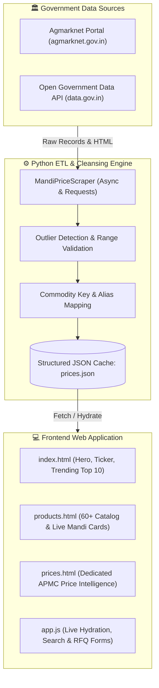

# 🌾 AgroReach India — Agri-Export Intelligence & Mandi Price Engine

[](https://developer.mozilla.org/en-US/docs/Web/HTML)
[](https://developer.mozilla.org/en-US/docs/Web/CSS)
[](https://developer.mozilla.org/en-US/docs/Web/JavaScript)
[](https://www.python.org/)
[](https://getbootstrap.com/)
[](https://data.gov.in/)

> **A modern B2B agricultural export portal and commodity price intelligence engine connecting global buyers with authentic, verified Indian Mandi pricing.**

---

## 📌 Executive Summary

**AgroReach India** is a full-stack agricultural commerce and market intelligence solution designed to eliminate information asymmetry in cross-border agricultural exports. Indian agricultural supply chains often face opaque middleman pricing; global buyers struggle to verify fair market rates for high-demand commodities like Cumin Seeds, Turmeric, Basmati Rice, and Alphonso Mangoes.

This project bridges that gap by combining:
1. **Automated Data Extraction & ETL Pipeline**: Python-driven scrapers that query Indian Open Government Data (`data.gov.in`) and the Agmarknet agricultural marketing network.
2. **Data Cleansing & Outlier Detection**: Statistical variance filtering to eliminate data entry anomalies (e.g., misquoted units or retail vs wholesale pricing).
3. **High-Performance Responsive Web Portal**: A clean, accessible frontend featuring real-time price tickers, multi-category filtering, instant product search, and Request-For-Quote (RFQ) workflows.

---

## 🌟 Key Features

### 🛒 1. Comprehensive Commodity Catalog (60+ Products)
- Detailed profiles for 8 major categories:
  - 🌶️ **Spices & Condiments**: Cumin, Turmeric, Red Chilli, Black Pepper, Cardamom, Coriander, Mustard, etc.
  - 🥭 **Fresh Fruits**: Alphonso Mango, Pomegranates, Grapes, Bananas, Apples.
  - 🧅 **Vegetables**: Nashik Onions, Potatoes, Tomatoes, Capsicum, Green Chillies.
  - 🌾 **Grains & Pulses**: Basmati Rice, Sharbati Wheat, Chana, Soybean, Moong, Urad.
  - 🥜 **Dry Fruits & Nuts**: Cashews (W320), Almonds, Walnuts, Raisins, Pistachios.
  - 🫙 **Oils & Oilseeds**: Groundnut, Mustard Seed, Sesame, Castor Seed.
  - 🍵 **Plantation & Commercial**: Darjeeling Tea, Arabica/Robusta Coffee, Raw Rubber.
- HS Codes, Minimum Order Quantities (MOQ), origin regions, and high-resolution visuals for each commodity.

### 📊 2. Real-Time Mandi Price Tracking
- Tracks three critical market figures per quintal (100 kg):
  - **Min Price**: Lowest registered APMC price.
  - **Max Price**: Premium batch ceiling price.
  - **Modal Price**: The statistically dominant wholesale clearing price.
- Live ticker animation highlighting intraday market swings and mandi volume updates.

### 🛡️ 3. Smart Data Cleaning & Unit Normalization
- Indian mandi data can suffer from unit confusion (e.g., per kg coriander greens recorded alongside per quintal coriander seed).
- Python scrapers integrate range-bound validation (`PRICE_RANGE` tables) and median outlier rejection to guarantee clean, export-accurate commercial prices.

### ⚡ 4. Interactive UX & Instant Discovery
- **Instant Search**: Real-time keyword filtering across names, varieties, and botanical aliases.
- **Category Switcher**: One-tap categorization tabs synchronized with select dropdowns.
- **B2B Inquiry System**: Integrated modals and quote submission forms for buyers to request custom export packaging and shipping quotes.
- **Mobile-First Responsive Layout**: Smooth slide-out mobile drawer, touch-friendly carousel controls, and responsive grid layouts.

---

## 🏗️ Architecture & Data Flow



---

## 🛠️ Tech Stack

| Domain | Technologies & Tools | Purpose |
| :--- | :--- | :--- |
| **Frontend** | HTML5, CSS3, Vanilla JavaScript (ES6+) | Core user interface, DOM manipulation, asynchronous state |
| **Styling & UI** | CSS Custom Properties, Bootstrap 5.3, Google Fonts | Responsive layouts, typography (Playfair Display + DM Sans), responsive carousel |
| **Backend & Scraping** | Python 3.9+, `requests`, `beautifulsoup4`, `aiohttp` | Mandi data harvesting, HTML parsing, async HTTP pooling |
| **Data Cleaning** | Python `statistics`, regex pattern matching | Unit normalization, outlier filtering, min/max calculations |
| **Data Format** | JSON (REST-like static data layer) | Seamless frontend-backend decoupling |
| **Version Control** | Git, GitHub | Source code tracking, releases, documentation |

---

## 📂 Project Directory Structure

```text
Export Website/
├── index.html                 # Main landing page (Hero, top products, value props, certifications)
├── products.html              # Complete 60+ commodity catalog with min/max/modal pricing
├── prices.html                # Live Mandi price board and commodity trend viewer
├── style.css                  # Unified responsive stylesheet and design system
├── app.js                     # Client-side interactions, price ticker, search & quote modal
│
├── scraper.py                 # Core Python scraper for data.gov.in & Agmarknet endpoints
├── claude_scraper.py          # Enhanced scraper with statistical outlier & unit cleansing
├── kimi_scraper.py            # Async aiohttp scraper with retry policies & 50+ item mapping
│
├── commodities.json           # Master dictionary of commodities and search aliases
├── prices.json                # Generated live price cache consumed by the web app
├── prices_20260330_0003.json  # Historical sample export snapshot (50 commodities)
├── requirements.txt           # Python dependencies for scraper execution
├── .env.example               # Template for data.gov.in API authentication
└── README.md                  # Comprehensive project documentation
```

---

## 🚀 Getting Started

### Prerequisites
- Modern web browser (Chrome, Edge, Firefox, Safari)
- [Python 3.9+](https://www.python.org/downloads/) (for running the data scrapers)
- [Git](https://git-scm.com/) installed

### 1. Clone the Repository
```bash
git clone https://github.com/your-username/agroreach-india.git
cd agroreach-india
```

### 2. Set Up Python Scraper Environment
```bash
# Create a virtual environment
python -m venv venv

# Activate the virtual environment
# Windows:
.\venv\Scripts\activate
# Linux/macOS:
source venv/bin/activate

# Install dependencies
pip install -r requirements.txt
```

### 3. Configure API Credentials (Optional but Recommended)
1. Register for a free API key at [data.gov.in](https://data.gov.in/).
2. Copy the template:
   ```bash
   cp .env.example .env
   ```
3. Add your API key in `.env`:
   ```env
   DATA_GOV_API_KEY=your_registered_api_key_here
   ```

### 4. Fetch the Latest Mandi Prices
Execute the automated scraper:
```bash
python scraper.py
```
*This fetches current mandi reports, validates price ranges, and writes updated data directly into `prices.json`.*

### 5. Launch the Web Application
Because modern browsers enforce CORS restrictions when fetching local JSON files via `file://`, serve the project using any local HTTP server:

```bash
# Using Python's built-in HTTP server:
python -m http.server 8000
```
Open your browser and navigate to:
```text
http://localhost:8000
```

---

## 💡 Engineering Highlights

1. **Defensive Data Ingestion**: Open government APIs occasionally return variable column names (`modal_price`, `price`, `avg_price`, `modal`). The scraper employs fallback attribute resolution and multi-endpoint polling to maximize ingestion success.
2. **Zero-Dependency Frontend**: The application achieves sub-second load times without heavy client-side frameworks, demonstrating solid mastery of semantic HTML5, pure CSS variables, and vanilla JavaScript.
3. **Resilient Offline UX**: If network requests to live data fail, the application gracefully falls back to cached baseline prices and informs the user rather than rendering empty states.

---

## 🔮 Future Roadmap

- [ ] **FastAPI / Flask Microservice**: Expose a dedicated REST API (`/api/v1/prices`, `/api/v1/rfq`) with SQLite/PostgreSQL caching.
- [ ] **Automated GitHub Actions Cron**: Run the scraper automatically every morning at 09:30 AM IST and push updated `prices.json` via CI/CD.
- [ ] **Currency Converter**: Dynamic conversion from INR (₹/quintal) to USD ($/metric ton) and EUR (€/metric ton) for international buyers.
- [ ] **Interactive Price Charts**: Historical 30-day and 90-day price trend graphs using Chart.js.

---

## 👨‍💻 Author & Academic Background

- **Developer**: Diploma in Computer Engineering Fresher
- **Focus Areas**: Web Development, Python Automation, Data Ingestion, Full-Stack Fundamentals
- **Connect**: [LinkedIn Profile](https://linkedin.com) • [GitHub Profile](https://github.com)

---

## 📄 License

This project is licensed under the **MIT License** — you are free to inspect, modify, and build upon it for academic and professional purposes.
