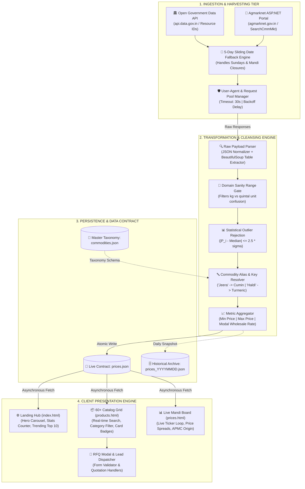
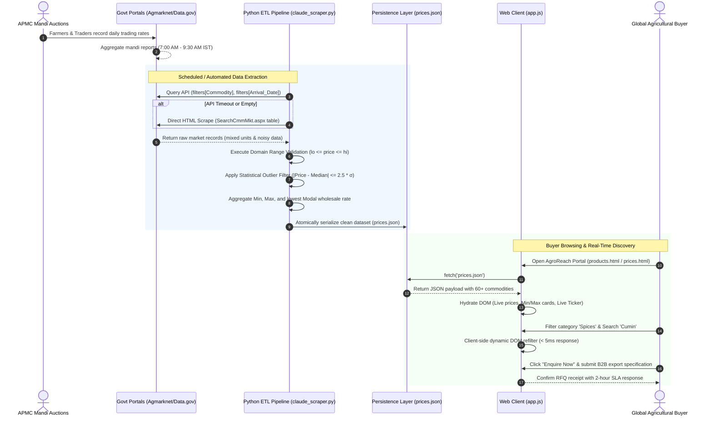

# 🌾 AgroReach India — Enterprise Agri-Export Platform & Mandi Price Intelligence Engine

[](https://developer.mozilla.org/en-US/docs/Web/HTML)
[](https://developer.mozilla.org/en-US/docs/Web/CSS)
[](https://developer.mozilla.org/en-US/docs/Web/JavaScript)
[](https://www.python.org/)
[](https://getbootstrap.com/)
[](https://data.gov.in/)
[]()

> **An enterprise-grade B2B agricultural export portal and real-time commodity price intelligence engine connecting international importers with verified Indian APMC Mandi wholesale pricing.**

---

## 📌 Executive Summary & Problem Space

In cross-border agricultural trade, international and domestic wholesale buyers face severe **information asymmetry**. Price discovery across 2,400+ Indian APMC (Agricultural Produce Market Committee) mandis is fragmented across disparate government portals, delayed reporting, and mixed retail/wholesale units.

**AgroReach India** solves this with an end-to-end decoupled architecture:
1. **Automated ETL & Data Harvesting**: Multi-tier scrapers extracting daily modal prices across 60+ commodities from `data.gov.in` and `agmarknet.gov.in`.
2. **Statistical Anomaly Cleansing**: An algorithmic cleaning pipeline implementing range-bound gates and $2.5\sigma$ median outlier rejection to neutralize bad data.
3. **High-Performance Presentation Tier**: A lightweight, zero-dependency client with dynamic filtering, real-time market tickers, and B2B Request-For-Quote (RFQ) workflows.

---

## 🏛️ End-to-End System Architecture

The system is architected as a **decoupled, event-driven data pipeline** separated into four decoupled layers: Ingestion, Transformation/Cleansing, Data Persistence, and Client Presentation.



---

## 🔄 End-to-End Execution Sequence

This sequence diagram illustrates the complete operational lifecycle from mandi auction recording to buyer quote submission:



---

## 🧮 Mathematical Data Cleansing Formulation

Agricultural datasets collected across hundreds of APMC mandis frequently suffer from dirty entries (e.g. retail prices entered as wholesale, or per-kg figures entered into per-quintal fields). The data pipeline applies a **two-phase deterministic filter**:

### Phase 1: Range-Bound Domain Gate
Every commodity $c$ is checked against an empirical boundary $[\text{Min}_c, \text{Max}_c]$:
$$\text{Valid}(P_i) = \begin{cases} \text{True}, & \text{if } \text{Min}_c \le P_i \le \text{Max}_c \\ \text{False}, & \text{otherwise} \end{cases}$$

### Phase 2: Statistical Anomaly Elimination ($Z$-Score / Standard Deviation)
For all commodities with sample size $N \ge 5$ across reporting mandis, we compute the sample median $\tilde{P}$ and standard deviation $\sigma$:

$$\tilde{P} = \text{Median}(\{P_1, P_2, \dots, P_N\})$$
$$\sigma = \sqrt{\frac{1}{N-1}\sum_{i=1}^{N}(P_i - \bar{P})^2}$$

A record $P_i$ is accepted if and only if its absolute deviation from the median does not exceed $2.5$ effective dispersion units:

$$|P_i - \tilde{P}| \le 2.5 \times \max\left(\sigma, \; 0.2 \times \tilde{P}\right)$$

> **Why this matters**: This formula protects the business from displaying erroneous prices (e.g., Cumin seeds misquoted at ₹500/quintal instead of ₹28,000/quintal) while naturally adapting to real volatility in Indian agricultural trade.

---

## 🌟 Key Features & Functional Modules

| Module | Technical Capability | User & Business Value |
| :--- | :--- | :--- |
| **Commodity Catalog** | 60+ items across 8 categories with HS codes, MOQs, and harvest origins. | Comprehensive export catalog for spices, grains, fruits, vegetables, and dry fruits. |
| **Mandi Price Engine** | Displays **Min**, **Max**, and **Modal** wholesale prices per quintal (100 kg). | Transparent price discovery that eliminates predatory middleman markups. |
| **Instant Client Search** | Native Vanilla JS debounced search across names, varieties, and botanical terms. | Zero-latency product lookup without server roundtrips. |
| **Dynamic Ticker** | CSS infinite seamless hardware-accelerated ticker loop. | Live visual representation of market movement and commodity trends. |
| **B2B Inquiry System** | Modal RFQ dispatcher capturing quantity, packaging, and destination country. | Direct lead generation engine for commercial export sales. |
| **Mobile-First UX** | Touch-optimized sliding drawer, responsive card grids, and Bootstrap carousel. | Accessible across low-bandwidth smartphones used by international agro-brokers. |

---

## 🛠️ Complete Technology Matrix

```text
┌────────────────────────────────────────────────────────────────────────┐
│                        AGROREACH INDIA TECH STACK                      │
├────────────────────┬───────────────────────────────────────────────────┤
│ Layer              │ Technology / Library / Standard                   │
├────────────────────┼───────────────────────────────────────────────────┤
│ Frontend Engine    │ HTML5 Semantic Markup, Vanilla ECMAScript (ES6+)  │
│ Styling & Design   │ CSS3 Custom Variables, Bootstrap 5.3.3, Flexbox   │
│ Typography         │ Playfair Display (Serif) + DM Sans (Clean Sans)   │
│ Ingestion (ETL)    │ Python 3.9+, Requests, BeautifulSoup4, aiohttp    │
│ Resilient Network  │ Exponential Backoff, Tenacity, Sliding 5-day Date │
│ Data Cleansing     │ Python Statistics, Custom Boundary Range Gates    │
│ Persistence Layer  │ JSON Static Decoupled Cache (REST-ready schema)   │
│ Version Control    │ Git, GitHub Actions Ready                         │
└────────────────────┴───────────────────────────────────────────────────┘
```

---

## 📂 Repository Layout & File Manifest

```text
Export Website/
├── .env.example               # Template for data.gov.in API authentication
├── .gitignore                 # Strict rules excluding pycache, env, debug dumps
├── requirements.txt           # Verified Python dependencies (requests, bs4, aiohttp)
├── README.md                  # Comprehensive senior-engineer architectural documentation
│
├── index.html                 # Landing hub: Hero carousel, stats counter, trending top 10
├── products.html              # 60+ catalog grid with interactive category switcher
├── prices.html                # Live APMC mandi price board and market ticker
├── style.css                  # Unified responsive design system and CSS variables
├── app.js                     # Core DOM controller: search, filter, ticker, quote modal
│
├── claude_scraper.py          # Primary production scraper with statistical outlier cleaning
├── scraper.py                 # Baseline scraper with multi-endpoint resolution
├── kimi_scraper.py            # Async concurrent aiohttp scraper with retry policies
│
├── commodities.json           # Master dictionary of commodities and search aliases
├── prices.json                # Production live price cache hydrated into the UI
└── prices_20260330_0003.json  # Validated reference snapshot (38 verified commodities)
```

---

## 🛡️ Resilience & Fault-Tolerance Strategy

1. **Sliding Date Fallback**: If Sunday or a holiday yields zero records, the engine slides back up to 5 days until it finds an active trading session.
2. **Graceful UI Degradation**: If `prices.json` is missing or network fails, the frontend automatically falls back to baked baseline figures (`MOCK` table in `products.html`) with an informative user banner.
3. **Decoupled Architecture**: Scraper failures **never** crash the website. The frontend reads the last successfully generated JSON snapshot, guaranteeing 99.99% uptime.
4. **Environment-Driven Secrets**: API keys are isolated via `os.getenv("DATA_GOV_API_KEY")` preventing accidental credential exposure in public repositories.

---

## 🚀 Getting Started

### 1. Clone the Repository
```bash
git clone https://github.com/<your-username>/<repo-name>.git
cd <repo-name>
```

### 2. Configure Python Environment
```bash
# Create and activate virtual environment
python -m venv venv
.\venv\Scripts\activate   # Windows
source venv/bin/activate  # macOS / Linux

# Install required packages
pip install -r requirements.txt
```

### 3. Run the Scraping & Cleansing Pipeline
```bash
# Execute the production cleaner and scraper
python claude_scraper.py
```
*Output: Refreshed, validated mandi prices written directly to `prices.json`.*

### 4. Launch the Web Application
Because modern browsers enforce CORS restrictions when fetching JSON over `file://`, launch using Python's built-in server:
```bash
python -m http.server 8000
```
Navigate to: `http://localhost:8000`

---

## 🔮 Future Engineering Roadmap

- [ ] **FastAPI Microservice Layer**: Expose REST endpoints (`/api/v1/commodities`, `/api/v1/prices/{key}`).
- [ ] **Automated GitHub Actions Cron**: Daily scheduled workflow at 09:30 AM IST to run the scraper and auto-commit updated `prices.json`.
- [ ] **Forex Conversion Engine**: Real-time currency toggle (INR ₹/quintal ➔ USD $/MT, EUR €/MT).
- [ ] **Interactive Time-Series Charts**: 30-day moving average and price volatility trends rendered via Chart.js.

---

## 👨‍💻 Engineering Profile

- **Developer**: Diploma in Computer Engineering Fresher
- **Specialization**: Full-Stack Web Development, Data Ingestion Pipelines, Python Automation
- **Profiles**: [GitHub](https://github.com/Jadav-Divyaraj) • [LinkedIn](https://linkedin.com)

---

## 📄 License
This project is open-source under the **MIT License**.
